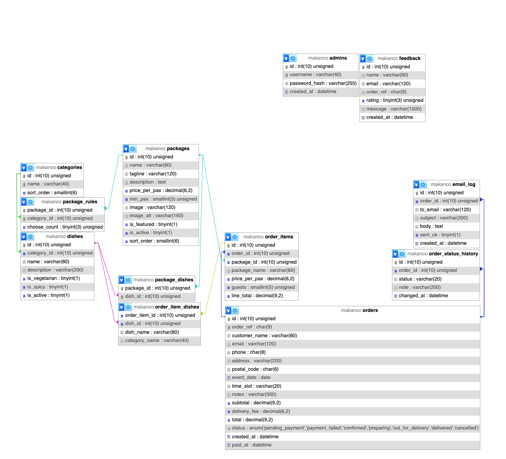

# Makan & Co. (IE4727 project)

Online buffet catering portal (Theme 1). The base version in `base/` uses only HTML, CSS, JavaScript, PHP and MySQL, as the project guidelines require. The modern version is in `modern/` (see the end of this file).

## Run it with XAMPP (Mac or Windows)

1. **Start Apache and MySQL** in the XAMPP control panel.
2. **Create the database.** In phpMyAdmin (http://localhost/phpmyadmin), open the *Import* tab and import `db/schema.sql`, then `db/seed.sql`. From a terminal instead:
   ```
   mysql -u root < db/schema.sql
   mysql -u root < db/seed.sql
   ```
   (On a Mac the client is `/Applications/XAMPP/xamppfiles/bin/mysql`.)
3. **Put the site in `htdocs`.** Copy the `base` folder to XAMPP's `htdocs` and rename it `makanco`, or link it so edits show up immediately:
   - Mac: `ln -s "$PWD/base" /Applications/XAMPP/xamppfiles/htdocs/makanco`
   - Windows (admin prompt): `mklink /D C:\xampp\htdocs\makanco C:\path\to\repo\base`

   If a Mac shows "403 Forbidden" after you link the folder, see [Common problems](#common-problems).
4. Open http://localhost/makanco/

The database login is in `base/includes/config.php` (XAMPP's default is user `root` with no password).

**Staff area:** http://localhost/makanco/admin.php (also linked in the footer). Username `admin`, password `admin123`.

## Email (optional)

The site sends an email when an order is confirmed, when a payment is declined, when staff change an order's status, and when feedback arrives. Every email is also saved to the `email_log` table and shown under *Admin > Email log*, so the demo works without a mail server.

To receive the emails in a real inbox, use [Mailpit](https://mailpit.axllent.org/). It catches all mail locally, so nothing is sent outside your machine, as the brief requires. Start Mailpit, then set one line in XAMPP's `php.ini` and restart Apache:

- Windows: `SMTP=localhost` and `smtp_port=1025`
- Mac: `sendmail_path = "/usr/local/bin/mailpit sendmail -t"` (Apple silicon Homebrew: `/opt/homebrew/bin/mailpit`)

Read the emails at http://localhost:8025. Mailpit catches every address, so test with addresses like `name@localhost`, which all four validators accept.

## Common problems

### Mac: "403 Forbidden" at http://localhost/makanco/ after linking `base`

Apache's error log (`/Applications/XAMPP/xamppfiles/logs/error_log`) shows:

```
AH00037: Symbolic link not allowed or link target not accessible: /Applications/XAMPP/xamppfiles/htdocs/makanco
```

There's nothing wrong with the link, and XAMPP already allows symlinks (`FollowSymLinks` in `httpd.conf`). The problem is permissions. XAMPP runs Apache as the `daemon` user, and macOS doesn't let other users open your home folder (`/Users/<you>` is `drwxr-x---`). So Apache can't reach the repo the link points to.

The fix is to run Apache as your own user:

1. Open `/Applications/XAMPP/xamppfiles/etc/httpd.conf` and find `User daemon` (around line 173). Change it to your macOS username (`whoami` prints it). Leave `Group daemon` as it is:
   ```
   User yourname
   Group daemon
   ```
2. Delete the session files Apache saved while it ran as `daemon`. If you don't, phpMyAdmin can fail with `session_start(): open(...) failed: Permission denied (13)`:
   ```
   find /Applications/XAMPP/xamppfiles/temp -name 'sess_*' ! -user "$USER" -delete
   ```
3. Restart Apache in the XAMPP control panel.
4. Check it: `curl -I http://localhost/makanco/` should print `HTTP/1.1 200 OK`.

Notes:
- Don't keep the repo in `Desktop`, `Documents` or `Downloads`. macOS privacy protection blocks Apache from those folders even after this fix. A folder directly in your home folder, such as `~/IE4727-proj-main`, works.
- Copying `base` into `htdocs` instead of linking it also avoids the problem, but then you have to copy it again after every edit.
- `chmod o+x ~` also fixes it, but it lets every account on the Mac into your home folder, so changing Apache's user is safer.
- Windows doesn't have this problem.

## Pages

| Page | Purpose |
|---|---|
| `index.php` | Home: featured packages from the database, how ordering works |
| `buffets.php` | All packages (server-generated), sortable, comparison table |
| `package.php` | Dish picker: guest count and "choose N per category" rules |
| `cart.php` | Session cart: change guest numbers, remove packages, live totals |
| `checkout.php` | Guest checkout form (HTML5 + JavaScript + PHP validation) |
| `payment.php` | Stand-in for the third-party payment gateway: success or declined |
| `track.php` | Order lookup by order number and email, status timeline |
| `about.php` | About, delivery and set-up terms, time slot table, FAQ |
| `contact.php` | Contact details and feedback form with star rating |
| `admin.php` | Staff area (one page, tabs chosen with `?view=`): orders, packages, dishes and categories, reports, feedback, email log, staff accounts |

## Business rules

- Orders need at least **3 days' notice** and can be placed up to 6 months ahead.
- Delivery is **$30**, or free from **$500**.
- Each package has a **minimum number of guests**; the maximum is 500.

### Rules kept in two places

The rules are set in `base/includes/config.php`. The modern version's Go API can't read PHP constants, so it keeps **a copy in `modern/api/rules.go`**. When you change a rule, change it in both files, or the two sites will accept and price orders differently.

| Rule | Current value | Base: `base/includes/config.php` | Modern: `modern/api/rules.go` |
|---|---|---|---|
| Notice needed | 3 days | `LEAD_DAYS` | `leadDays` |
| Latest booking | 180 days ahead | `MAX_DAYS_AHEAD` | `maxDaysAhead` |
| Most guests per package | 500 | `MAX_GUESTS` | `maxGuests` |
| Delivery and set-up fee | $30 | `DELIVERY_FEE` (`30.00`) | `deliveryFeeCts` (`3000`, in cents) |
| Free delivery from | $500 | `FREE_DELIVERY_MIN` (`500.00`) | `freeDeliveryCts` (`50000`, in cents) |
| Delivery time slots | 11:00, 12:00, 15:00 and 18:00, one hour each | `$timeSlots` | `timeSlots` (same text, e.g. `"11:00 - 12:00"`) |
| Order status names | "Awaiting payment", "Confirmed"… | `$statusLabels` | `statusLabels` |
| Brand and contact details | Makan & Co., +65 6123 4567, makanco@localhost | `SITE_NAME`, `CONTACT_PHONE`, `CONTACT_EMAIL` | `siteName`, `contactPhone`, `contactEmail` |

Not copied, so there is nothing to keep in step:
- **Prices, minimum guests, dishes and "choose N" rules** are in the database (`packages`, `package_rules`, `package_dishes`), which both versions read.
- **The React app** gets the rules from the Go API (`GET /api/rules`), so it never needs editing.
- **At most 20 packages per order** exists only in the Go API (`maxCartItems`); the PHP cart has no limit.

The form checks are also written more than once, because each version validates in the browser and again on the server:

| Check | Base, server | Base, browser | Modern, server | Modern, browser |
|---|---|---|---|---|
| Name, email, Singapore phone and postal code, order number | `base/includes/functions.php` (`validName()`, `validEmail()`…) | `pattern` attributes in `base/checkout.php` and `base/js/forms.js` | `modern/api/validate.go` | `modern/web/src/lib/validation.ts` |
| Exactly N dishes per course | `validateDishSelection()` in `functions.php` | `base/js/package.js` | `validateDishSelection()` in `validate.go` | `modern/web/src/pages/Package.tsx` |

All four email checks also accept local test addresses such as `name@localhost`. One small difference: the base site's JavaScript wants at least two letters after the last dot of an email (`name@site.sg`); the other three checks accept one.

## Database

One MySQL/MariaDB database, `makanco`, with 12 tables. It's created by `db/schema.sql`, and both versions use it. The seed data in `db/seed.sql` has 12 fictional sample orders, so the reports aren't empty.

### Tables

`→` marks a foreign key, e.g. `category_id → categories` links to `categories.id`.

| Table | Holds | Columns |
|---|---|---|
| **Menu** | | |
| `packages` | Buffet packages, priced per guest | `id`, `name`, `tagline`, `description`, `price_per_pax`, `min_pax`, `image`, `image_alt`, `is_featured`, `is_active`, `sort_order` |
| `categories` | Courses that dishes are grouped into (Mains, Desserts…) | `id`, `name` (unique), `sort_order` |
| `dishes` | Individual dishes | `id`, `category_id → categories`, `name`, `description`, `is_vegetarian`, `is_spicy`, `is_active` |
| `package_rules` | How many dishes the customer picks from each category of a package ("choose 3 Mains") | `package_id → packages`, `category_id → categories` (the two together are the primary key), `choose_count` |
| `package_dishes` | Which dishes each package offers (many-to-many) | `package_id → packages`, `dish_id → dishes` (the two together are the primary key) |
| **Orders** | | |
| `orders` | One order, with the customer's details (guest checkout, no accounts) | `id`, `order_ref` (unique, e.g. `MC-7K3QX2`), `customer_name`, `email`, `phone`, `address`, `postal_code`, `event_date`, `time_slot`, `notes`, `subtotal`, `delivery_fee`, `total`, `status`, `created_at`, `paid_at` |
| `order_items` | One row per package in an order | `id`, `order_id → orders`, `package_id → packages` (can be empty), `package_name`, `price_per_pax`, `guests`, `line_total` |
| `order_item_dishes` | The dishes chosen for each order item | `order_item_id → order_items`, `dish_id → dishes` (can be empty), `dish_name`, `category_name` |
| `order_status_history` | Every status change, shown as the timeline on the tracking page | `id`, `order_id → orders`, `status`, `note`, `changed_at` |
| `email_log` | A copy of every email the site sends | `id`, `order_id → orders` (can be empty), `to_email`, `subject`, `body`, `sent_ok`, `created_at` |
| **Other** | | |
| `feedback` | Messages from the contact form | `id`, `name`, `email`, `order_ref` (optional), `rating`, `message`, `created_at` |
| `admins` | Staff accounts | `id`, `username` (unique), `password_hash`, `created_at` |

`orders.status` is one of `pending_payment`, `payment_failed`, `confirmed`, `preparing`, `out_for_delivery`, `delivered` or `cancelled`. `orders` is indexed on `email`, `status` and `event_date`.

### How the tables relate



The diagram above is a screenshot of phpMyAdmin's Designer view. To see the live version, open phpMyAdmin, choose `makanco`, then the *Designer* tab, which is under *More* on narrow windows (http://localhost/phpmyadmin/index.php?route=/database/designer&db=makanco). Each coloured line joins a foreign key to the table it points to. `admins` and `feedback` aren't linked to any other table.

The text diagrams below show the same links, plus which side of each link is "one" and which is "many". `1` and `N` mark one-to-many links (one category has many dishes).

**Menu.** A package's menu is its rules (which categories, and how many dishes to pick from each) combined with the dishes it offers, grouped by each dish's category. (`pkg_id` and `cat_id` are short for `package_id` and `category_id`.)

```
  ┌──────────────┐ 1          N ┌──────────────────┐
  │ categories   │──────────────│ dishes           │
  │ PK id        │              │ PK id            │
  │    name (UQ) │              │ FK category_id   │
  │    sort_order│              │    is_vegetarian │
  └──────┬───────┘              │    is_spicy      │
         │ 1                    │    is_active     │
         │                      └────────┬─────────┘
         │                               │ 1
         │ N                             │ N
  ┌──────┴───────┐              ┌────────┴─────────┐
  │ package_rules│              │ package_dishes   │
  │ PK FK pkg_id │              │ PK FK package_id │
  │ PK FK cat_id │              │ PK FK dish_id    │
  │ choose_count │              └────────┬─────────┘
  └──────┬───────┘                       │ N
         │ N                             │
         │                               │
         │ 1                             │ 1
         │        ┌──────────────┐       │
         └────────│ packages     │───────┘
                  │ PK id        │
                  │ price_per_pax│
                  │ min_pax      │
                  │ is_featured  │
                  │ is_active    │
                  └──────────────┘
```

**Orders.** `──<` means one-to-many. At checkout, each order item copies the package's name and price, and each chosen dish copies its name and category. Editing or deleting the menu later never changes a past order.

```
orders                         PK id, order_ref UQ, customer + event details,
 │                             subtotal/delivery_fee/total, status
 │
 ├──< order_items              FK order_id               CASCADE
 │     │                       FK package_id → packages  nullable, SET NULL
 │     │                       package_name, price_per_pax  ← copied at checkout
 │     │
 │     └──< order_item_dishes  FK order_item_id          CASCADE
 │                             FK dish_id → dishes       nullable, SET NULL
 │                             dish_name, category_name  ← copied at checkout
 │
 ├──< order_status_history     FK order_id               CASCADE
 │
 └──< email_log                FK order_id               nullable, SET NULL

feedback.order_ref ·····> orders.order_ref    text match only, no foreign key
admins                                        not linked to other tables
```

### What happens when a row is deleted

| Foreign key | On delete | Effect |
|---|---|---|
| `dishes.category_id` → `categories` | Blocked (the default) | A category can't be deleted while dishes use it |
| `package_rules` → `packages` and `categories` | CASCADE | A package's rules are deleted with it |
| `package_dishes` → `packages` and `dishes` | CASCADE | The links are deleted with the package or dish |
| `order_items.order_id` → `orders` | CASCADE | Deleting an order also deletes its items, their chosen dishes and its history |
| `order_items.package_id` → `packages` | SET NULL | Past orders keep the copied package name and price |
| `order_item_dishes.dish_id` → `dishes` | SET NULL | Past orders keep the copied dish name |
| `email_log.order_id` → `orders` | SET NULL | The email log keeps emails for deleted orders |

### Rules the database doesn't enforce

These rules are checked in the code instead:

- **There's no cart table.** A cart only becomes rows in `orders` at checkout. Until then, the base site keeps it in the PHP session.
- **`feedback.order_ref` is plain text.** A customer can type any order number; nothing checks it against `orders`.
- **`order_status_history.status` is free text.** It isn't limited to the status list above, but it's only ever written by the same code that changes `orders.status`.
- **A package can offer too few dishes for its rules**, e.g. "choose 3 Mains" when only two Mains are offered. Nothing in the database prevents this, so the staff *Packages* tab lists any package where it happens.

### Create, read, update, delete

Customers check out as guests (no accounts) and are kept informed by email. Staff manage the data from the staff area:

| Table | Create | Read | Update | Delete |
|---|---|---|---|---|
| packages | New package | Buffets, package, staff Packages tab | All fields, "choose N" rules, dishes offered, photo | Yes; past orders keep their copied name and price |
| dishes | New dish | Package menus, staff Dishes tab | Edit form, available/hidden switch | Yes; past orders keep the dish name |
| categories | Add | Dishes tab | Rename, reorder | Only when no dishes use it |
| orders | Checkout | Track page, staff Orders tab | Payment result, staff status changes | Only unpaid or cancelled orders; paid orders are kept for sales records |
| feedback | Contact form | Staff Feedback tab | none (it is the customer's own words) | Yes (e.g. spam) |
| admins | Staff tab | Staff tab | Change password | Yes, except your own account |

Every delete asks for confirmation in the browser and is checked again on the server.

## Modern version

`modern/` holds the additional version: a React + TypeScript + Tailwind CSS single-page app (`modern/web`) with a Go API (`modern/api`). It uses the **same `makanco` database**, so orders placed there appear in this staff area, and status changes made here show up live on its tracking page. Setup and details: [modern/README.md](modern/README.md).
